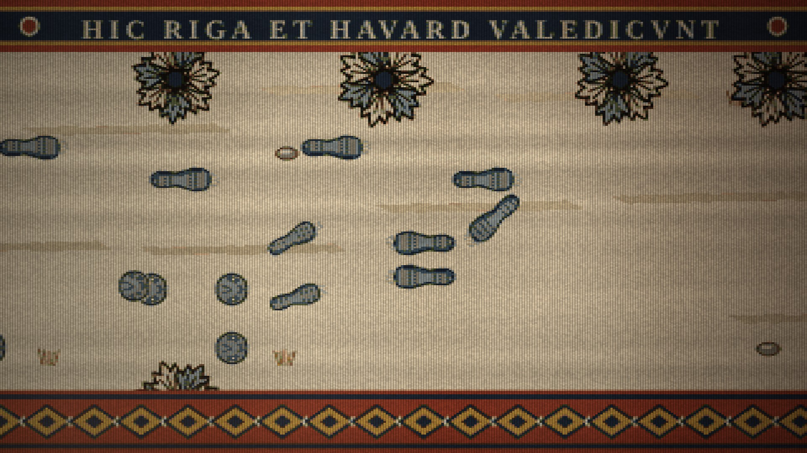
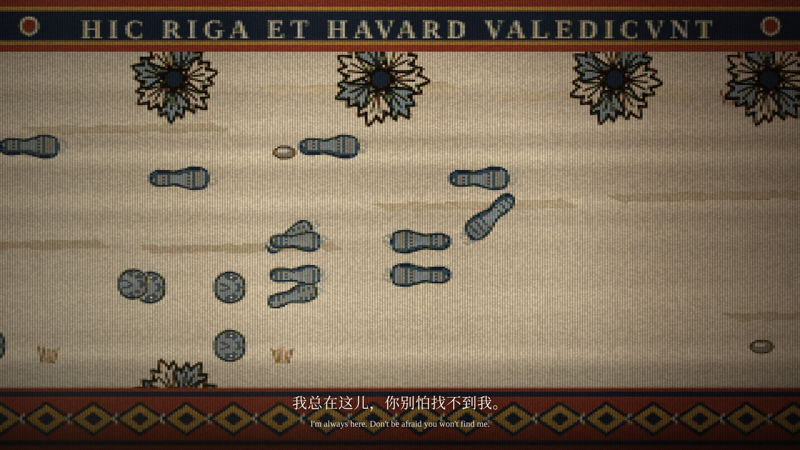
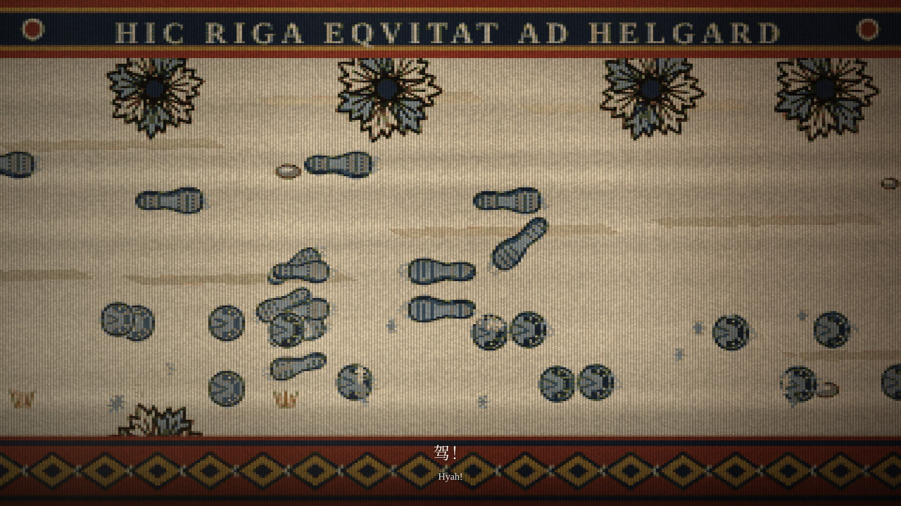
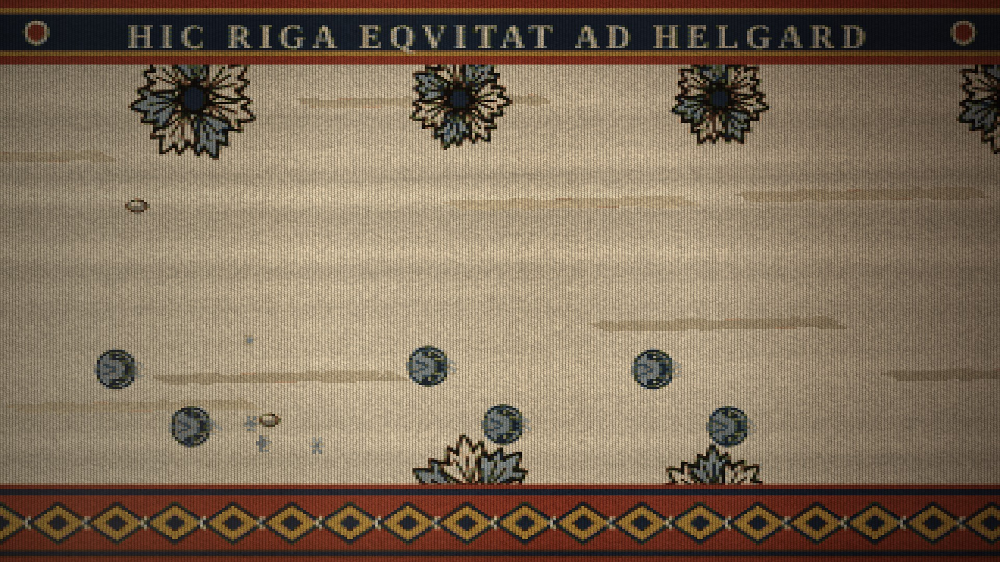

# 《文舟 0.9.9》宣传片故事板（第六版：脚印一路走到结尾）

改编自《炉火祈愿》第一部 · 2 分 49 秒 · 16:9 横屏 · 19 个分镜

第五版按审核意见修改：

- 全片的树与画面风格统一为已通过的阿瑟、辛弗兰两段的织法；
- 第一幕的长枪、树与尸体，铁砧，以及马和人的脚印全部重新绘制，不沿用旧素材；
- 铁砧改为纯侧面、无火星，镜头一路推近白热的铁块，直到白成雪地；
- 脚印改为俯视的两排。

第六版按审核意见修改：

- 删去皮培奔跑的镜头，“驾！”之后由蹄印一路跑到结尾；
- 脚印重新设计得更写实，间距按真实步幅加大；
- 镜头跟着脚印移动，雪地、石头、枯草与树冠随之后退。

动态效果见 `storyboard/preview-trail.mp4`（12 帧/秒、无声的动态小样）。

目前已通过的是阿瑟（05—06）与辛弗兰（07—08）两段，其余镜头待审核。关键帧见 `storyboard/frames/`，总览见 `storyboard/contact-sheet.jpg`。**审核通过后再渲染成片。**

## 一、美术设定

### 统一的织法（以阿瑟、辛弗兰两段为准）

- **织造：** 经距 6 px、纬高 4 px 的粗织，染料平涂，两色交界处梳齿状交错，同色有染缸批次的深浅条纹，炉火光从左下方照来。
- **造型：** 动物和物件都织成一整块剪影：
  - 深色毛线勾边，边缘内侧再织一道另一种颜色的内轮廓线；
  - 动物的肩、胯织螺旋纹；
  - 远侧四肢织成更深的颜色，压在身后。
- **树：** 一律用卷枝纹样（S 形枝条，枝端扇形叶）。冬天叶为浅菘蓝与漂白，树干为靛蓝。
- **版式：** 上方是拉丁铭文花边（“HIC……”，此处……），下方是菱格花边。
- **气息与风：** 都用波纹带表现。阿瑟温暖的鼻息是茜草红与木樨草黄，里加冷的呼吸是漂白与浅菘蓝，辛弗兰的寒风是菘蓝与靛蓝。

### 不出现人物

| 镜头 | 代替人物的痕迹 |
| --- | --- |
| 03—04 | 大树旁插着的长枪、枪头下的红布条、从树后吹出的白色呼吸波纹 |
| 09—11 | 铁砧上一块白热的铁，嘶嘶冒着蒸汽 |
| 12—18 | 雪地上俯视的脚印：哈沃德在前，皮培在后；分别；蹄印奔离，一直跑进未织完的经线 |

### 角色与物件

- **脚印（写实）：** 按 1 米 = 480 px 的比例织出：
  - 哈沃德的靴底长约 30 厘米，有宽的前掌、收窄的足弓和脚跟，左右脚各不相同；
  - 印坑靠光的一侧是阴影，坑底受光，带鞋底纹，脚尖前推起一点雪；
  - 里加的靴印比哈沃德的小一成半；
  - 皮培钉了马掌的蹄印：圆形蹄痕、最深的一圈马掌印和钉眼、蹄叉；走路时后蹄落在前蹄印之后，奔跑时四蹄一组，蹄尖更深，并踢起雪。
- **步幅：** 哈沃德每步 0.75 米；马走路每 0.8 米一对蹄印，左右交替；奔跑时一步约 2 米以上，越跑越远。
- **战场：** 按贝叶挂毯的程式织出：
  - 一匹侧卧的死马，四腿收在身下，头搁在雪上，身上积雪；
  - 盾（茜草红配木樨草黄的四分纹）、头盔、折断的长矛；
  - 覆雪的低丘，暗示倒下的人。
- **铁砧：** 纯侧面的剪影（角、砧面、砧尾、腰、座），靛蓝内轮廓线，立在胡桃褐的木墩上。

### 不变的部分

- 开场与落版按 0.9.8 宣传片的样式。
- 字幕：思源宋体，中英双语。
- 文舟界面：保持应用本身的配色，叠在最上层。

## 二、时间线的改动

| 内容 | 原时间 | 现时间 |
| --- | --- | --- |
| Logo 出场 | 00:00—00:04 | 00:00—00:04.5 |
| 四角燃烧 | 00:04—00:09 | 00:04.5—00:09 |
| 第 01 句独白 | 00:10.4 起 | 00:04.6 起（燃烧开始时） |

00:17.6 以后不变。

## 三、详细分镜

### 第一幕：火焰与逃亡（00:00—00:23）

**镜头 01｜00:00—00:04.5｜文舟启动**


与 0.9.8 宣传片相同的出场：深绿色径向渐变、左上柔光、底部三层波浪。图标由 0.6 倍放大到原大并轻微转正，随后出现“文舟 Vela”与“0.9.9 · 开源小说创作与阅读工具”。

**镜头 02｜00:04.5—00:09｜从四角烧开**


四角同时焦黑、透出橙光，燃烧的边缘向中央推进，露出镜头 03 的挂毯，最后吞没 Logo。燃烧一开始，里加的独白响起：“我死死地攥着手里的长枪，弓着身子，跪在牲畜和人的尸体中……”

**镜头 03｜00:09—00:17｜战后的林子**


- **画面：**
  - 冬天的挂毯：天空两道浅菘蓝的云带，远山，卷枝纹的冬树成林。
  - 前景是战场：侧卧的死马、盾、头盔、折断的长矛、覆雪的低丘。
  - 右边一棵大树，旁边插着一杆长枪，枪头下系着红布条；白色的呼吸波纹从树后吹出。里加就在树后。
  - 铭文“HIC RIGA IN SILVA LATET”（此处里加藏身林中）。
- **动态：** 镜头沿挂毯缓慢推近大树；呼吸波纹一呼一吸地织出、淡去；远处马蹄声愈来愈近。

**镜头 04｜00:17—00:23｜寒风**


- **画面：**
  1. 推近长枪与呼吸，红布条被风扯向左方；
  2. 菘蓝的风纹、雪花纹样与旋涡从右侧一条条织入，盖满画面。
- **独白：** “麦依尔曾对我说过，冬天是辛弗兰给予战士的怜悯。”

### 第二幕：大熊与寒鸦（00:23—00:59）

**镜头 05｜00:23—00:36｜大熊阿瑟**


- **画面：**
  1. 春天的原野，大熊四足站立，鼻息化作波纹融化积雪，嫩芽冒出。铭文“HIC ARTHVR VRSVS NIVEM SOLVIT”。
  2. 鼓点落下，挂毯抖动，大熊重织为直立咆哮的姿态，鸟群惊飞。铭文“HIC ARTHVR VRSVS BELLVM CLAMAT”。
- **动态：** 姿态切换用织机式重织（从上到下逐纬扫过）。
- **独白：** “大熊阿瑟用它温暖的鼻息融化积雪，将露出的大地作为战场，吼叫着呼喊战争。”
- **软件功能：** 文舟术语库浮层：选中“阿瑟”→“更多 → 加入术语库”→ 填写“阿瑟｜精魂｜大熊精魂”→“词条已加入术语库”→ 收起为标签“阿瑟 · 大熊精魂”。

**镜头 06｜00:36—00:40｜春天升入冬天**


竖长挂毯上摇：地面被茜草红浸透，向上的卷枝树冠由绿转黄、转褐、转白，雪花纹样出现。独白：“而当战士们的血浸染大地时……”

**镜头 07｜00:40—00:55｜寒鸦辛弗兰**


- **画面：**
  1. 修长的寒鸦停在松枝顶上，颈部一圈浅色领羽。铭文“HIC SINFRAN MONEDVLA”。
  2. 双翅高举，挂毯织满风纹与雪花。铭文“HIC SINFRAN VENTVM MOVET”。
- **动态：** 三次振翅各重织一个姿态，落在鼓点上，每拍天气更冷。
- **独白：** “辛弗兰就用它的翅膀扇起寒风，用寒冷与死亡恐吓战士们，让他们对战争望而却步。”
- **软件功能：** 左上角浮层建立词条“辛弗兰｜精魂｜寒鸦精魂”。

**镜头 08｜00:55—00:59｜从寒雪到炉火**


冬天的挂毯从右边散开，纬线头在黑暗里烧成火星；最亮的一枚落下，变成铁砧上那块白热的铁。独白：“在今天之前，我都不曾领会这种仁慈。”

### 第三幕：铁匠与少年（00:59—01:27）

**镜头 09｜00:59—01:11｜铁砧上的铁**


- **画面：** 纯侧面。左边是砌石的炉子，火焰织成扇形；墙上挂着锤与钳。铁砧立在木墩上，砧面上放着一块烧得发白的铁：铁心是漂白，边缘是木樨草黄，外圈是一道道茜草红的热浪弧线。蒸汽织成白色波纹升起。铭文“HIC FERRVM HAVARDI CANDET”（此处哈沃德的铁烧得发白）。没有锤，没有火星。
- **动态：** 镜头从这里开始持续推近铁块，直到镜头 11。热浪弧线随炉火明灭，蒸汽波纹升起。
- **声音：** 铁在砧上嘶嘶作响，与低音鼓点相合。
- **独白：** “每当我看着他用锤子砸在烧得发白的铁块上，滋滋作响的火星飞着溅射出来，我眼睛就移不开了。”

**镜头 10｜01:11—01:22｜关系的建立**


- **画面：** 继续推近，铁块和蒸汽占据画面中部。
- **软件功能：** 文舟人物关系浮层：节点“里加”“哈沃德”，连线“抚养与照料”。
- **独白：** “我害怕它们，但我的眼睛却会被它们吸引。”
- **对白（哈沃德）：** “你会习惯的，人总是会习惯的。”

**镜头 11｜01:22—01:27｜白热变成雪**


推到铁块的白色占满画面，整个画面变白；白色里织出浅浅的雪纹，就是镜头 12 的雪地，第一枚脚印开始出现。最后一声嘶响化为风声与踩雪声。

### 第四幕：漫长的告别（01:27—02:08）

**镜头 12｜01:27—01:38｜两排脚印**


- **画面：** 俯视的雪地，上下两边是从上方看到的树冠。两排脚印从左向右延伸：
  - 上排是哈沃德的靴印，走在前面；
  - 下排是皮培的蹄印，落后两米。

  铭文“HIC HAVARD ET RIGA PROFICISCVNTVR”（此处哈沃德与里加启程）。
- **动态：** 脚印按步速一个个织出；镜头以步行速度跟着他们向右移动，雪地的纹理、石头、枯草随之后退。树冠离镜头更近，后退得更快（视差）。
- **对白（哈沃德）：** “就到这儿吧，从这里去海尔加德，一直骑上半天也就到了，不算远。”

**镜头 13｜01:38—01:56｜哈沃德的嘱咐（地图）**


雪地织成一幅地图：因舍森的山、卷枝小树、柯戈德河、太阳纹罗盘，萨卡莱特、艾洛夫、盎讷、海尔加德之间是茜草红的虚线道路。地图工具栏“瑞达内.vlmp”，“信息点”高亮，鼠标随对白落点。地图在镜头 14 开始时再变回雪地。

**镜头 14｜01:56—02:08｜拥抱**




- **画面：** 回到雪地，镜头停住。
  1. 两排脚印都停下。哈沃德从他那一排向下迈一步，转身面朝马。
  2. 皮培的蹄印并成一对。
  3. 马的近侧出现里加较小的靴印，一步步走上来，停在哈沃德面前，两双脚尖相对。

  铭文“HIC RIGA ET HAVARD VALEDICVNT”。
- **动态：** 里加的脚印一个个出现；停下后画面静止良久，只有炉火光明灭；音乐几乎静止。
- **对白（哈沃德）：** “我总在这儿，你别怕找不到我。”

### 第五幕：奔向未知（02:08—02:41）

**镜头 15｜02:08—02:17｜策马**




- **画面：**
  1. 里加的脚印走回马旁。喊出“驾！”的同时，蹄印拉开成奔跑：四蹄一组，蹄尖更深，后面踢起雪。
  2. 镜头追着蹄印加速向右，哈沃德那双脚印留在原地，退出画面左侧。

  铭文“HIC RIGA EQVITAT AD HELGARD”。
- **对白（少年里加）：** “驾！”
- **声音：** 马蹄声与鼓点同步，蹄印的落下也卡在同一节拍上。

**镜头 16｜02:17—02:31｜流动的世界**


镜头继续高速跟着蹄印，雪地与树冠不断后退；文舟大纲面板在右侧随马蹄节拍展开六个节点。

**镜头 17｜02:31—02:36｜最后的回忆**


大纲收起；前方的雪地织到了尽头，只剩光秃的经线和松脱的纬线头。蹄印一直延伸到织好的边缘为止。独白：“而在这之后，我也再没见过哈沃德。”

**镜头 18｜02:36—02:41｜奔入黑暗**


镜头越过边缘进入只有经线的黑暗，画面渐暗至黑；马蹄声在最后一个强鼓点戛然而止。

### 第六幕：文舟（02:41—02:49）

**镜头 19｜02:41—02:49｜终幕**


与开场同样的 0.9.8 式画面：图标、“文舟 Vela”、“0.9.9 · 让故事，自此起航。”、“现已上架鸿蒙应用市场”；几枚火星从下方升起，与开场的燃烧呼应。

## 四、制作方式

| 元素 | 实现 |
| --- | --- |
| 织锦 | `samples/loom.js`：在织造网格上绘制，按染料色板量化（含交错与染色条纹），再放大并叠加毛线肌理与炉火光 |
| 剪影 | `wFigure`：把动物或物件的各部分合成一个剪影，在网格上计算勾边与内轮廓线 |
| 脚印 | `trail()` 记下每个脚印出现的时刻与位置；`trailCam(t)` 决定镜头跟随的位置；`trailFrame(t)` 画出任意时刻的画面 |
| 开场与落版 | 按 `promo/video.html`（0.9.8 宣传片）的配色、图标动画与波浪重绘 |
| 文舟功能 | 沿用前几版的界面层 |

```sh
node promo/0.9.9/storyboard/render.mjs        # → storyboard/frames/*.jpg
python3 promo/0.9.9/storyboard/sheet.py       # → storyboard/contact-sheet.jpg
node promo/0.9.9/storyboard/preview.mjs       # → storyboard/preview-trail.mp4（脚印段的动态小样）
```
