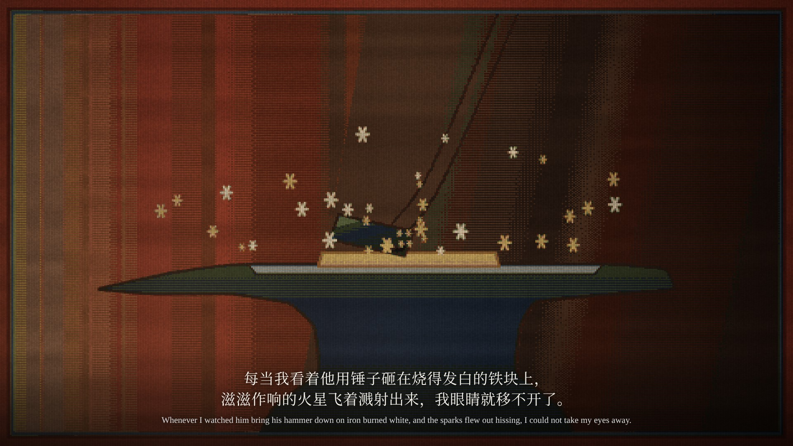
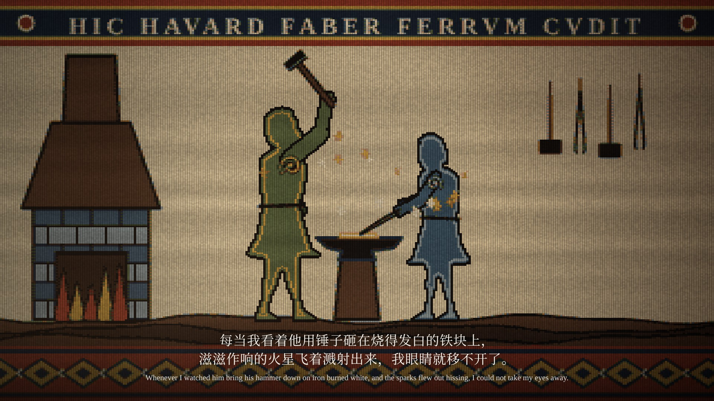
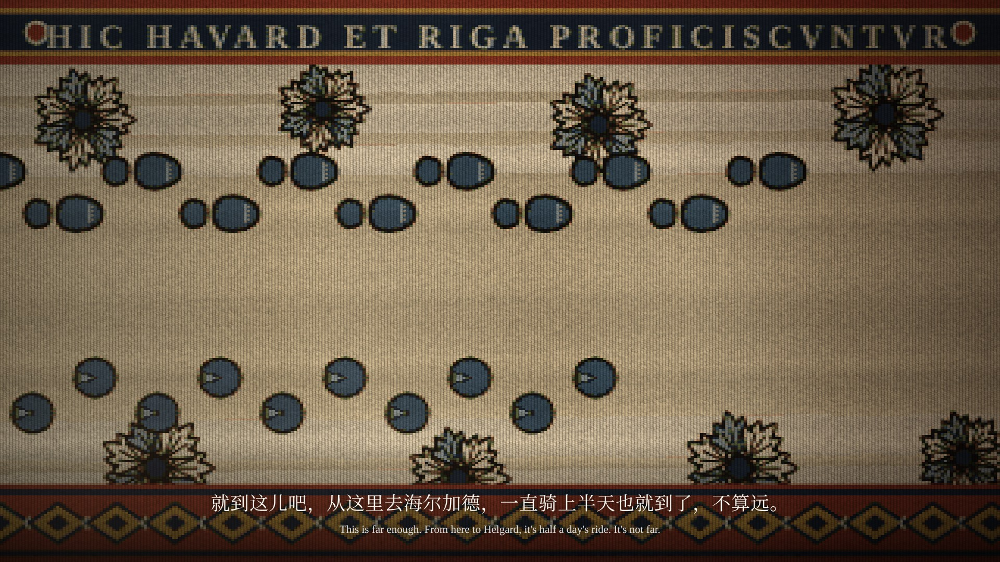

# 《文舟 0.9.9》宣传片故事板（第四版：全片织锦，不出现人物）

改编自《炉火祈愿》第一部 · 2 分 49 秒 · 16:9 横屏 · 19 个分镜

第四版按审核意见修改：去掉稿纸风格；开场沿用 0.9.8 宣传片的 Logo 出场，然后画面从四角烧开；全片所有场景都织成挂毯；**画面里不出现任何人物**。对白、配音、配乐与文舟功能露出不变。关键帧见 `storyboard/frames/`，总览见 `storyboard/contact-sheet.jpg`。**本稿用于审核，审核通过后再渲染成片。**

## 一、美术设定

### 全片织锦

- 每个画面都是一幅挂毯：逐纬织造的毛线肌理，两色交界处梳齿状交错，同色有染缸批次造成的横向深浅条纹，被炉火从左下方照亮。
- 视角不限于侧面：可以用纵深透视的道路、高视点的雪原、低机位的铁砧特写。
- 两种织法：
  - **尘世**（松林、铁匠铺、道路、地图、马）：按 15—16 世纪佛兰德挂毯的织法。
    - 用同一染料的浅、中、深三个色阶织出明暗；色阶之间织成阶梯状的交错线（hachure）。
    - 深褐色勾边，加褶线。
    - 织得更密（经距 4 px，纬高 3 px）。
    - 外框是窄的茜草红布边，内侧一道菘蓝细线。
  - **传说**（大熊阿瑟、寒鸦辛弗兰）：保持上一版通过的维京织法。
    - 一整块剪影，加内轮廓线与关节螺旋纹；树用卷枝纹样。
    - 上方是拉丁铭文花边，下方是菱格花边。
    - 织得更粗（经距 6 px，纬高 4 px）。

  两种织法的区别本身就是叙事：精魂是古老传说里的形象，里加的往事是后来的人织下的。

### 不出现人物

哈沃德和里加只以他们留下的东西出现：

| 镜头 | 代替人物的痕迹 |
| --- | --- |
| 03—04 | 插在大云杉旁的长枪、枪头下的红布条、从树后飘出的白气、走到树后的一行脚印 |
| 09—10 | 高举的铁锤（锤柄伸出画面）、夹着铁的钳子；锤与钳放在铁砧上，一根红线把两者缝在一起 |
| 12 | 一行蹄印、一行靴印，并排走向岔路 |
| 14 | 皮培在岔路口等着；雪地里两双靴印脚尖对着脚尖，大的那双转回村子 |
| 15 | “驾！”时蹄印骤然拉长成奔跑，雪尘扬起；哈沃德的靴印留在路边 |
| 15—18 | 皮培独自奔跑，不加马鞍和缰绳，像大熊与寒鸦一样成为象征，而不是一匹空鞍的马 |

### 造型

- **皮培（马）：** 与大熊阿瑟同样抽象：一整块枣红色剪影（鬃毛与尾巴并入轮廓），深色毛线勾边，内侧一道赭黄内轮廓线，肩与胯织螺旋纹，远侧两腿织成更深的颜色压在身后，蹄为黑色。奔跑姿势按参考照片：近侧前腿着地并略向后，远侧前腿屈起，近侧后腿向前收到腹下，远侧后腿在后方蹬地。
- **辛弗兰（寒鸦）：** 按参考照片改得更修长：长翼收拢、长尾、粗喙，颈部一圈浅色领羽，停在一根松枝的顶端。仍保留维京织法的内轮廓与螺旋纹。
- **大熊阿瑟：** 不变。

### 染料色板

本白、漂白、茜草红（浅、中、深）、枣红（浅、中、深）、木樨草黄（浅、中、深）、草绿与苔绿（浅、中、深）、菘蓝（浅、中、深）与靛蓝、胡桃褐（浅、中、深）、灰、铁黑。色值见 `samples/loom.js` 的 `DYE` 与 `RAMP`。

### 不变的部分

- 字幕：思源宋体，中英双语。
- 文舟界面（术语库、人物关系、地图工具栏、大纲）：保持应用本身的配色，叠在最上层。

## 二、时间线的改动

开场改为 Logo 出场后从四角燃烧，里加的第一句独白随燃烧开始：

| 内容 | 第三版 | 第四版 |
| --- | --- | --- |
| Logo 出场 | 00:00—00:04 | 00:00—00:04.5 |
| 四角燃烧 | 00:04—00:09 | 00:04.5—00:09 |
| 第 01 句独白 | 00:10.4 起 | 00:04.6 起（燃烧开始时） |
| 第 02 句独白 | 00:17.6 起 | 不变 |

00:23 以后的时间线全部不变。

## 三、详细分镜

### 第一幕：火焰与逃亡（00:00—00:23）

**镜头 01｜00:00—00:04.5｜文舟启动**


与 0.9.8 宣传片相同的出场：深绿色径向渐变背景，左上一团柔和的绿光，底部三层缓慢起伏的波浪。文舟图标由 0.6 倍放大到原大并轻微转正，随后出现“文舟 Vela”与“0.9.9 · 开源小说创作与阅读工具”。

**镜头 02｜00:04.5—00:09｜从四角烧开**


- **画面：** 画面四角同时焦黑、透出橙光，四道燃烧的边缘向中央推进，烧穿处露出镜头 03 的挂毯；最后 Logo 被吞没。
- **动态：** 燃烧边缘扩张，焦屑卷起，火星飘散。
- **独白（成年里加，燃烧开始时）：** “我死死地攥着手里的长枪，弓着身子，跪在牲畜和人的尸体中……”

**镜头 03｜00:09—00:17｜战后的松林**


- **画面：**
  - 冬天的挂毯：高地平线，远山与一层层云杉林越远越淡。
  - 雪原上是覆雪的低丘（倒下的人与牲畜）、斜插的长矛、半埋的盾和一面红旗。
  - 右侧一棵大云杉，枝上压着雪；树干旁插着一杆长枪，枪头下系着红布条。
  - 一行脚印走到树后，小团白气从树干边缘飘出。里加就在树后。
- **动态：** 镜头沿挂毯缓慢推近大云杉；白气一团团织出、散开；远处马蹄声愈来愈近。

**镜头 04｜00:17—00:23｜寒风**


- **画面：**
  1. 推近长枪与红布条，布条被风扯向左方；
  2. 风起，挂毯上织满白色的风纹与旋涡。
- **动态：** 布条抖动；风纹从右向左一条条织入，最后整幅变白，接入大熊的挂毯。
- **独白：** “麦依尔曾对我说过，冬天是辛弗兰给予战士的怜悯。”

### 第二幕：大熊与寒鸦（00:23—00:59）

**镜头 05｜00:23—00:36｜大熊阿瑟**


- **画面：**
  1. 春天的原野，大熊四足站立，鼻息化作波纹融化积雪，嫩芽冒出。铭文“HIC ARTHVR VRSVS NIVEM SOLVIT”。
  2. 鼓点落下，挂毯抖动，大熊重织为直立咆哮的姿态，鸟群惊飞。铭文“HIC ARTHVR VRSVS BELLVM CLAMAT”。
- **动态：** 姿态切换用织机式重织（从上到下逐纬扫过）。
- **独白：** “大熊阿瑟用它温暖的鼻息融化积雪，将露出的大地作为战场，吼叫着呼喊战争。”
- **软件功能：** 文舟术语库浮层：选中“阿瑟”→“更多 → 加入术语库”→ 填写“阿瑟｜精魂｜大熊精魂”→“词条已加入术语库”→ 收起为标签“阿瑟 · 大熊精魂”。

**镜头 06｜00:36—00:40｜春天升入冬天**


竖长挂毯上摇：地面被茜草红浸透，向上的卷枝树冠由绿转黄、转褐、转白，雪花纹样出现。独白：“而当战士们的血浸染大地时……”

**镜头 07｜00:40—00:55｜寒鸦辛弗兰**


- **画面：**
  1. 修长的寒鸦停在松枝顶上，颈部一圈浅色领羽。铭文“HIC SINFRAN MONEDVLA”。
  2. 双翅高举，挂毯织满风纹与雪花。铭文“HIC SINFRAN VENTVM MOVET”。
- **动态：** 三次振翅各重织一个姿态，落在鼓点上，每拍天气更冷。
- **独白：** “辛弗兰就用它的翅膀扇起寒风，用寒冷与死亡恐吓战士们，让他们对战争望而却步。”
- **软件功能：** 左上角浮层建立词条“辛弗兰｜精魂｜寒鸦精魂”。

**镜头 08｜00:55—00:59｜从寒雪到炉火**


冬天的挂毯从右边散开，纬线头在黑暗里烧成火星；最亮的一枚落下，接入锻击。独白：“在今天之前，我都不曾领会这种仁慈。”

### 第三幕：铁匠与少年（00:59—01:27）

**镜头 09｜00:59—01:11｜铁匠铺里的火**




- **画面：**
  1. 铁砧特写：锤面砸在烧白的铁上，锤柄伸出画面右上，火星迸射；
  2. 铁匠铺全景：木板墙上映着炉火，墙上挂着锤与钳，窗外是雪中的云杉。铁锤高举在铁砧上方（锤柄伸出画面），一把钳子夹着铁，火星飞散。
- **动态：** 每记锻击切在冲击瞬间：白闪、挂毯抖动、火星迸射后冷却。
- **独白：** “每当我看着他用锤子砸在烧得发白的铁块上，滋滋作响的火星飞着溅射出来，我眼睛就移不开了。”

**镜头 10｜01:11—01:22｜关系的建立**


- **画面：** 锤子放下，横在铁砧上，旁边是那把钳子；一根红线一针一针从铁锤缝向钳子。
- **软件功能：** 文舟人物关系浮层：节点“里加”“哈沃德”，连线“抚养与照料”，与挂毯上的红线同步缝完。
- **独白：** “我害怕它们，但我的眼睛却会被它们吸引。”
- **对白（哈沃德）：** “你会习惯的，人总是会习惯的。”

**镜头 11｜01:22—01:27｜最后的火星**


泥地上最后一枚火星由红转暗，中心长出一片雪花；门口照进一道冷光，雪花飘入。

### 第四幕：漫长的告别（01:27—02:08）

**镜头 12｜01:27—01:38｜出村的路**



- **画面：** 纵深透视的雪路穿过两排云杉伸向远方，一行蹄印和一行靴印并排走向前方的岔路。
- **动态：** 镜头沿路推进，印迹自近向远逐个织出。
- **对白（哈沃德）：** “就到这儿吧，从这里去海尔加德，一直骑上半天也就到了，不算远。”

**镜头 13｜01:38—01:56｜哈沃德的嘱咐（地图）**


- **画面：** 雪地织成一幅地图：
  - 因舍森的山、成片的云杉；
  - 柯戈德河（菘蓝）；
  - 罗盘；
  - 萨卡莱特、艾洛夫、盎讷、海尔加德的屋顶，地名用宋体织出；
  - 茜草红的虚线道路；
  - 下方是“瑞达内”标签。
- **软件功能：** 地图工具栏“瑞达内.vlmp”，“信息点”高亮，鼠标随对白在各地落点。
- **对白（哈沃德）：** “但你别一直骑……这样你明天或是后天再到海尔加德。”

**镜头 14｜01:56—02:08｜拥抱**


- **画面：**
  1. 岔路口，皮培配着鞍静静站着；雪地里两双靴印脚尖对着脚尖，一双大、一双小。
  2. 印迹的近景：大的那双后退一步，转回村子的方向；蹄印向前延伸。
- **动态：** 第一张停留最久，只有炉火光明灭；音乐几乎静止。
- **对白（哈沃德，在第二张上）：** “我总在这儿，你别怕找不到我。”

### 第五幕：奔向未知（02:08—02:41）

**镜头 15｜02:08—02:17｜策马**


- **画面：**
  1. 喊出“驾！”的同时，路上的蹄印骤然拉长，雪尘扬起；哈沃德的靴印留在路边。
  2. 皮培独自奔跑，姿势按参考照片。
- **动态：** 镜头开始沿长卷横移，越来越快；马在两个奔跑姿态间随马蹄节拍交替重织。
- **对白（少年里加）：** “驾！”

**镜头 16｜02:17—02:31｜流动的世界**


挂毯长卷从右向左流过；文舟大纲面板在右侧随马蹄节拍展开六个节点。

**镜头 17｜02:31—02:36｜最后的回忆**


大纲收起；前方的挂毯织到了尽头，只剩光秃的经线和松脱的纬线头。独白：“而在这之后，我也再没见过哈沃德。”

**镜头 18｜02:36—02:41｜奔入黑暗**


皮培奔入只有经线的黑暗，颜色褪去，没入漆黑；马蹄声在最后一个强鼓点戛然而止。

### 第六幕：文舟（02:41—02:49）

**镜头 19｜02:41—02:49｜终幕**


与开场同样的 0.9.8 式画面：图标、“文舟 Vela”、“0.9.9 · 让故事，自此起航。”、“现已上架鸿蒙应用市场”；几枚火星从下方升起，与开场的燃烧呼应。

## 四、制作方式

| 元素 | 实现 |
| --- | --- |
| 织锦 | `samples/loom.js`：在织造网格上绘制，按染料色板量化（含交错与染色条纹），再放大并叠加毛线肌理与炉火光；尘世画面用三色阶渐变织出明暗 |
| 精魂 | `wFigure`：合成一个剪影，在网格上计算勾边与内轮廓线 |
| 开场与落版 | 按 `promo/video.html`（0.9.8 宣传片）的配色、图标动画与波浪重绘 |
| 文舟功能 | 沿用前几版的界面层 |

```sh
node promo/0.9.9/storyboard/render.mjs        # → storyboard/frames/*.jpg
python3 promo/0.9.9/storyboard/sheet.py       # → storyboard/contact-sheet.jpg
```
