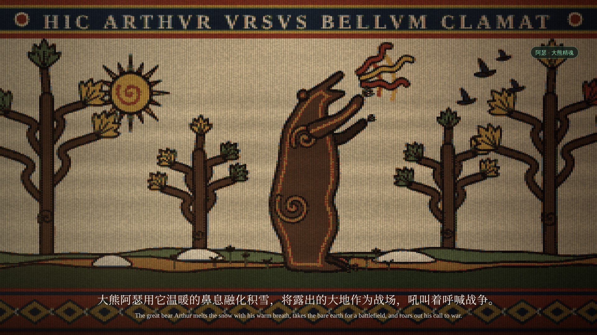

# 《文舟 0.9.9》宣传片故事板（第三版：痕迹、织锦与稿纸）

改编自《炉火祈愿》第一部 · 2 分 49 秒 · 16:9 横屏 · 19 个分镜

第三版重新设计美术风格，不再沿用第一、二版的侧面透视、低多边形与写实人体。对白、配音、配乐卡点与文舟功能露出不变。每个镜头的关键帧见 `storyboard/frames/`，总览见 `storyboard/contact-sheet.jpg`。**本稿用于审核，审核通过后再渲染成片。**

## 一、美术设定

### 三种画面语言

| 画面 | 用途 | 占比 |
| --- | --- | --- |
| **痕迹**（主） | 现在时的真实世界：松林、战场、铁匠铺的近景、出村的路、雪地 | 约一半 |
| **织锦**（辅） | 回忆与传说：精魂、人物的动作与关系，织在一幅挂在炉边墙上的挂毯上 | 约四成 |
| **稿纸**（转场） | 文舟的正文页：开场、燃烧、墨迹洇开的转场、地图、落版 | 其余 |

整体的叙事框架是：成年里加在炉火边回忆往事。“痕迹”是他记得的那个世界，“织锦”是被讲述成传说的那部分，“稿纸”是这部小说本身，也就是文舟。

### 痕迹

- **不出现人物。** 人只以痕迹出现：插在雪里的长枪、绑在枪上的茜草红布条、树后升起的白气、脚印与蹄印、铁砧上的铁、熄灭的火星。
- **视角自由。** 不再限于侧面：贴地低机位、近景特写、纵深透视的道路、俯看雪地，都可以用。
- **画法。** 不用低多边形。以平涂色块为底，加柔和的明暗渐变；远处偏蓝变淡并虚化（大气透视），前景虚焦（浅景深）；冬日低角度斜光、长影、逆光的白气；轻微胶片颗粒。云杉按真实树形生成：窄而高的塔形，一层层下垂的枝叶。
- **色彩。** 与织锦共用同一套染料色系：雪与雾是本白与浅菘蓝，阴影是菘蓝，唯一的暖色是茜草红的布条与火光，让两种画面切换时色调连贯。

### 织锦

- **参照。** 瑞典 Överhogdal 挂毯（维京时代，人物不画五官）、挪威 Baldishol 挂毯（12 世纪）、贝叶挂毯（马的奔驰姿态、上下花边、拉丁铭文），以及维京艺术中动物肩、胯处的螺旋纹（Mammen / Urnes 风格）。
- **造型规则（以大熊为准，所有动物和人物统一）：**
  - 每个角色是**一整块剪影**，只用一种染料平涂，外缘一圈深色毛线勾边；
  - 边缘内侧再织**第二道轮廓线**（另一种颜色）；
  - 肩、胯等关节处织**螺旋纹**；
  - 远侧的四肢单独织成更深的颜色，压在身后；近侧的手臂叠在身体上，有自己的勾边；
  - 人物不画五官，只靠头部侧面的轮廓（额、鼻、下巴、胡须、头发）辨认；成人约七个半头身。
- **角色配色：**

  | 角色 | 主色 | 内轮廓 |
  | --- | --- | --- |
  | 大熊阿瑟 | 胡桃褐 | 赭黄 |
  | 寒鸦辛弗兰 | 靛蓝 | 浅菘蓝 |
  | 哈沃德 | 草绿 | 木樨草黄 |
  | 里加 | 菘蓝 | 浅菘蓝 |
  | 皮培（马） | 茜草褐 | 赭黄 |

- **树。** 用本版确定的卷枝纹样：树干分出 S 形卷曲的枝条，枝端是扇形的叶（palmette）。春天为绿与黄，冬天为浅蓝与本白。
- **材质。** 逐纬织造：每一纬是一粒凸起的毛线，经线形成竖向的棱；两色交界处有梳齿状的交错（挂毯的 hatching）；同一颜色因染缸批次不同，有横向的深浅条纹（abrash）。画面对齐到织造网格（经距 6 px，纬高 4 px），轮廓因此呈阶梯状。
- **版式。** 上方花边带拉丁铭文，仿贝叶挂毯的“HIC……”（此处……）；下方是菱格花边。画面是一幅长卷，镜头沿长卷横移。
- **光。** 挂毯被炉火从左下方照亮，暖光随火焰明灭，呼应片名“炉火祈愿”。
- **动态。** 不做逐帧的肢体动画，只用：
  - 织机式重织：新姿态从上到下逐纬织出，像梭子扫过；
  - 挂毯随冲击抖动、起伏；
  - 毛线松脱、散开；
  - 火光明灭；
  - 镜头横移、推近。

### 稿纸

- 文舟的正文页：米黄色纸面、浅横线、宋体正文，页眉“炉火祈愿 · 第一部”，页脚“正文.txt”。
- 转场方式是墨从词条处洇开（边缘浓、中间淡，沿纸纤维长出毛刺），墨迹里显出下一幅画面；也可以是纸页烧穿。
- 地图也画在纸上，用墨线绘制：排线的山、小松树符号、双线河流、虚线道路、罗盘。

### 染料色板

| 名称 | 色值 | 用途 |
| --- | --- | --- |
| 本白 | `#ddcfae` | 织锦底色 |
| 漂白 | `#efe6d0` | 雪、爪、铭文 |
| 茜草红 | `#a5412d` | 花边、火、血、布条 |
| 茜草褐 | `#7a2f22` | 马 |
| 木樨草黄 | `#cf9f3e` | 太阳、火、内轮廓 |
| 赭黄 | `#a77436` | 内轮廓 |
| 草绿 / 苔绿 | `#62724a` / `#3f4b31` | 草地、春叶、哈沃德 |
| 菘蓝 / 浅菘蓝 | `#43607f` / `#8ea2b3` | 里加、冬叶、阴影 |
| 靛蓝 | `#25324a` | 寒鸦、花边 |
| 胡桃褐 / 深褐 | `#5b3d2c` / `#3a2a22` | 大熊、树干、土 |
| 铁黑 | `#1f1b1a` | 勾边 |
| 肤色 | `#d6a685` | 备用 |

### 不变的部分

- 字幕：思源宋体，中英双语。
- 文舟界面（术语库、人物关系、地图工具栏、大纲）：保持应用本身的深绿配色，不做风格化，叠在画面最上层。

## 二、详细分镜

### 第一幕：火焰与逃亡（00:00—00:23）

**镜头 01｜00:00—00:04｜文舟启动 · 稿纸**


- **画面：** 暗色桌面上一张米黄色正文页，印着《炉火祈愿》开篇三行。光点汇聚，页面上方出现文舟 Logo 与“文舟 0.9.9”，文字外描出一圈细线框。
- **动态：** 光点汇聚、线框描出、纸页渐显；镜头轻微推近。
- **声音：** 低沉的弓弦声，轻微纸张摩擦声。

**镜头 02｜00:04—00:09｜燃烧的纸页 · 稿纸 → 痕迹**


- **画面：** 纸页右下角焦黑、透出橙光，烧穿的洞里露出镜头 03 的松林。
- **动态：** 燃烧缺口扩大，边缘卷曲；焦屑与火星向镜头飘散；镜头推入缺口，直到松林占满画面。
- **声音：** 噼啪声渐被寒风取代，远处极微弱的马蹄声。

**镜头 03｜00:09—00:17｜战后的松林 · 痕迹**


- **画面：** 雾中的云杉林，浅景深。中景是战后的雪原：覆着薄雪的低丘（倒下的人与牲畜）、斜插的长矛、一面撕破的茜草红旗。右侧一棵粗大的云杉，树皮粗糙，右缘被低角度的阳光照暖。树干左缘露出一杆插在雪里的长枪，枪头下系着一条红布。脚印从画面左侧一路走到树后。**里加不出现**：他就跪在树后，只有一团团白气从树干边缘飘出来。
- **动态：** 镜头缓慢推近树干；远、中、近景视差；细雪；白气随呼吸一团团升起、散开。
- **独白（成年里加）：** “我死死地攥着手里的长枪，弓着身子，跪在牲畜和人的尸体中……”马蹄声愈来愈近。

**镜头 04｜00:17—00:23｜寒风 · 痕迹**


- **画面：**
  1. 长枪近景：枪杆磨得发亮，铁箍上结着霜；红布条被风扯向左方（马蹄声传来的方向）；树后吐出的白气也被吹向左方；背景虚化。
  2. 寒风卷起积雪，雪线从右侧成片扫入，画面变白。
- **动态：** 镜头极缓推近；布条抖动；风起时雪线越来越密，最后整幅变成白色，为下一镜的白纸作准备。
- **独白：** “麦依尔曾对我说过，冬天是辛弗兰给予战士的怜悯。”

### 第二幕：大熊与寒鸦（00:23—00:59）

**镜头 05｜00:23—00:36｜大熊阿瑟 · 稿纸 → 织锦**




- **画面：**
  1. 白雪变成白纸：正文页上写着“大熊阿瑟用它温暖的鼻息融化积雪，”，“阿瑟”二字被文舟选中（绿色底色、虚线下划线）。墨从“阿瑟”洇开，墨迹里露出织锦。
  2. 墨迹铺满后进入挂毯：春天的原野，卷枝纹的树，螺旋纹的太阳。大熊四足站立，低头，口鼻吐出茜草红与木樨草黄的波纹气息，前方的雪堆缩小，露出嫩芽。铭文“HIC ARTHVR VRSVS NIVEM SOLVIT”（此处大熊阿瑟融化积雪）。
  3. 鼓点落下：挂毯剧烈抖动，大熊重织为**直立、仰头咆哮**的姿态，口中放出波纹与三道圆弧，鸟群惊飞。铭文换成“HIC ARTHVR VRSVS BELLVM CLAMAT”（此处大熊阿瑟呼喊战争）。
- **动态：** 墨迹扩散；镜头沿挂毯横移；姿态切换用织机式重织（从上到下逐纬扫过，0.3 秒）并伴随挂毯抖动；咆哮时镜头略微上仰。
- **独白：** “大熊阿瑟用它温暖的鼻息融化积雪，将露出的大地作为战场，吼叫着呼喊战争。”
- **软件功能：** 念到“阿瑟”时，右上角出现文舟浮层：选中“阿瑟”，选区菜单“更多 → 加入术语库”，填写词条“阿瑟”、分类“精魂”、释义“大熊精魂”，保存后提示“词条已加入术语库”，收起为小标签“阿瑟 · 大熊精魂”。

**镜头 06｜00:36—00:40｜春天升入冬天 · 织锦**


- **画面：** 一幅竖长的挂毯，镜头自下而上上摇。最下方的地面被茜草红浸透；向上是一层层卷枝纹的树冠，叶色由绿转黄、转褐，最上方的叶子变成本白，雪花纹样开始出现。
- **动态：** 连续上摇，不硬切；红色从地面向上洇开，随即被逐纬织入的白色覆盖。
- **独白：** “而当战士们的血浸染大地时……”

**镜头 07｜00:40—00:55｜寒鸦辛弗兰 · 织锦**


- **画面：**
  1. 冬天的挂毯：浅蓝的山、霜色的卷枝树、雪地。一根树枝从右侧伸入，枝头栖着靛蓝色的寒鸦（与大熊同样的织法：内轮廓、翅膀上的螺旋纹、黑色的喙）。铭文“HIC SINFRAN MONEDVLA”（此处寒鸦辛弗兰）。
  2. 寒鸦双翅高举，挂毯上织满风的波纹与雪花纹样。铭文“HIC SINFRAN VENTVM MOVET”（此处辛弗兰扇起寒风）。
- **动态：** 三次振翅，每次重织一个姿态，落在鼓点上：
  1. 第一拍半展翅，山的颜色压暗；
  2. 第二拍双翅高举，风纹出现；
  3. 第三拍双翅下扇，雪花纹样铺满整幅。

  最后一面巨大的靛蓝翅膀纹样横扫镜头。
- **独白：** “辛弗兰就用它的翅膀扇起寒风，用寒冷与死亡恐吓战士们，让他们对战争望而却步。”
- **软件功能：** 左上角浮层选中“辛弗兰”，建立词条“辛弗兰｜精魂｜寒鸦精魂”，保存后淡出。

**镜头 08｜00:55—00:59｜从寒雪到炉火 · 织锦 → 痕迹**


- **画面：** 冬天的挂毯从右边散开：纬线一根根松脱，线头在黑暗里烧成橙红色，变成飞散的火星；中央一枚火星最亮。
- **动态：** 散线向左蔓延；火星飘向右方，最亮的一枚落下，白闪一帧，接入锻击。
- **独白：** “在今天之前，我都不曾领会这种仁慈。”

### 第三幕：铁匠与少年（00:59—01:27）

**镜头 09｜00:59—01:11｜铁匠铺里的火 · 痕迹 / 织锦**


- **画面：**
  1. 痕迹，贴着铁砧的低机位特写：画面里只有工具。左侧是炉火的光，铁砧上一块烧得发白的铁，锤头从画面上方砸下，火星迸射。
  2. 织锦：铁匠铺，左边是砌石的炉子与炉罩，墙上挂着锤与钳。哈沃德（草绿，满脸胡须）在铁砧左侧高举铁锤；里加（菘蓝）在右侧用钳子夹着铁，低头看着火星。铭文“HIC HAVARD FABER FERRVM CVDIT”（此处铁匠哈沃德锻铁）。
- **动态：** 前两记锻击在特写上：白闪一帧、画面震动、火星迸射后冷却（白→黄→橙→暗红）。第三记切到挂毯：锤子在两个姿态间重织（举起→落下），挂毯随锤击抖动，炉火明灭。
- **独白：** “每当我看着他用锤子砸在烧得发白的铁块上，滋滋作响的火星飞着溅射出来，我眼睛就移不开了。”
- **声音：** 锻击声与低音鼓点重合。

**镜头 10｜01:11—01:22｜关系的建立 · 织锦**


- **画面：** 同一幅挂毯。哈沃德的锤子落在铁上，他抬头看向里加；里加仍低头看火星。一根茜草红的线以平针一针一针从哈沃德缝向里加。
- **动态：** 文舟人物关系浮层展开：
  1. 先出现节点“里加”，再出现“哈沃德”；
  2. 连线由哈沃德指向里加，标注“抚养与照料”；
  3. 浮层连线与挂毯上的红线同步缝完。
- **独白：** “我害怕它们，但我的眼睛却会被它们吸引。”
- **对白（哈沃德）：** “你会习惯的，人总是会习惯的。”节点标签不用“父子关系”。

**镜头 11｜01:22—01:27｜离开工坊 · 痕迹**


- **画面：** 铁匠铺的泥地特写，炭灰散落。最后一枚火星由暗红变灰，中心浮出一个白点，长成一片雪花；门口透进来的冷光里飘着雪。
- **动态：** 雪花长成，画面由暗褐转向冬日的灰白，叠化入镜头 12。
- **声音：** 最后一记锤声的混响化为马的鼻息与踩雪声。

### 第四幕：漫长的告别（01:27—02:08）

**镜头 12｜01:27—01:38｜出村的路 · 痕迹**


- **画面：** 纵深透视：一条踩实的雪路在两排黑色树干之间伸向远方，在前方分岔。路上没有人，只有一行蹄印和一行靴印并排走来，在岔路口停住、踩乱。低角度的阳光把树干的影子横铺在雪上。
- **动态：** 镜头沿路缓慢推进；蹄印与靴印自近向远逐个印出；乌云的影子移过，画面变暗。
- **对白（哈沃德）：** “就到这儿吧，从这里去海尔加德，一直骑上半天也就到了，不算远。”

**镜头 13｜01:38—01:56｜哈沃德的嘱咐 · 稿纸（地图）**


- **画面：** 雪地化为纸面，墨线一笔一笔画出地图：
  - 因舍森的山（排线）；
  - 成片的小松树；
  - 柯戈德河（双线）；
  - 罗盘；
  - 萨卡莱特的屋顶，虚线道路依次连到艾洛夫、盎讷、海尔加德。
- **动态：** 随哈沃德说到每个地名，对应的标记落下、虚线延伸。
- **对白（哈沃德）：** “但你别一直骑……这样你明天或是后天再到海尔加德。”
- **软件功能：** 地图工具栏“瑞达内.vlmp”（绘制点、信息点、箭头、元素、边界）浮在上方，“信息点”高亮，鼠标随对白在各地点击落点。

**镜头 14｜01:56—02:08｜拥抱 · 织锦 → 痕迹**


- **画面：**
  1. 织锦：里加抱住哈沃德，头靠在他胸前，哈沃德的手臂搭在里加背上；皮培在一旁静静站着。铭文“HIC RIGA ET HAVARD VALEDICVNT”（此处里加与哈沃德道别）。
  2. 痕迹：他们站过的雪地。两双靴印脚尖对着脚尖，一双大一双小；蹄印向前延伸；那双大靴印转回村子的方向。
- **动态：** 第一张停留最久，挂毯只有火光明灭；叠化到第二张后雪花缓缓落下。音乐几乎静止。
- **对白（哈沃德，在第二张上）：** “我总在这儿，你别怕找不到我。”最后一个“我”字之后保持短暂寂静。

### 第五幕：奔向未知（02:08—02:41）

**镜头 15｜02:08—02:17｜策马 · 织锦**


- **画面：**
  1. 里加已在马背上，俯身握缰；哈沃德站在路旁抬头看他。铭文“HIC HAVARD RIGAM DIMITTIT”（此处哈沃德送别里加）。
  2. 喊出“驾！”的同时，挂毯重织为奔驰：马按贝叶挂毯的奔马程式，前腿屈起，后腿蹬地；里加的斗篷向后扬起。铭文“HIC RIGA EQVITAT AD HELGARD”（此处里加骑向海尔加德）。
- **动态：** 镜头开始沿长卷横移，越来越快；马在两个奔驰姿态之间随马蹄节拍交替重织；每一拍挂毯轻微下沉。
- **对白（少年里加）：** “驾！”
- **声音：** 弓弦转入强节奏，马蹄声配合鼓点加速。

**镜头 16｜02:17—02:31｜流动的世界 · 织锦**


- **画面：** 奔马固定在画面左中，挂毯长卷从右向左流过：霜色的卷枝树、雪花纹样、蹄印。
- **动态：** 文舟大纲面板在右侧依次展开节点：“逃亡的松林”“大熊阿瑟”“寒鸦辛弗兰”“哈沃德的铁匠铺”“离开萨卡莱特”“前往海尔加德”。节点与连线的出现落在马蹄节拍上。
- **声音：** 无新对白，留给音乐与功能展示。

**镜头 17｜02:31—02:36｜最后的回忆 · 织锦**


- **画面：** 大纲收拢后淡出。前方的挂毯织到了尽头：再往前只剩光秃的经线，松脱的纬线头垂着，后面是黑暗的墙。
- **动态：** 长卷继续加速左移，奔马向织到一半的边缘冲去。
- **独白（成年里加，沉静）：** “而在这之后，我也再没见过哈沃德。”

**镜头 18｜02:36—02:41｜奔入黑暗 · 织锦 → 黑**


- **画面：** 奔马越过织好的部分，进入只有经线的黑暗；颜色迅速褪去，只剩一圈暗淡的轮廓，最后没入漆黑。
- **声音：** 马蹄声在最后一个强鼓点戛然而止，仅剩短暂风声。

### 第六幕：文舟（02:41—02:49）

**镜头 19｜02:41—02:49｜终幕 · 稿纸**


- **画面：** 黑暗中一枚暖白色微光扩散成文舟 Logo，依次出现“文舟”“0.9.9”“让故事，自此起航。”“现已上架鸿蒙应用市场”；几枚橙红色火星从下方升起，与开篇燃烧的纸页呼应。
- **动态：** Logo 轻微放大，最后淡出至黑。
- **声音：** 低沉温暖的弦乐和声结束全片。

## 三、与第二版的对照

| 镜头 | 第二版 | 第三版 |
| --- | --- | --- |
| 03—04 | 跪在树根旁的里加静帧、侧脸与拳头特写 | 不出现里加：长枪、红布条、树后的白气、脚印 |
| 05 | 熊形徽记 | 墨从“阿瑟”洇开 → 织锦中的大熊，重织为咆哮 |
| 06 | 纵向长卷静帧 | 竖长挂毯上摇，红色洇开后被白色织没 |
| 07 | 寒鸦徽记三个姿态 | 织锦寒鸦三次重织，风纹与雪花纹样 |
| 08 | 雪粒变成火星 | 挂毯散线，线头烧成火星 |
| 09 | 三张锤击静帧 | 两记锻击用铁砧特写（只有工具），第三记切到织锦 |
| 10 | 两张静帧叠化 | 织锦上一根红线从哈沃德缝向里加，与关系图同步 |
| 12 | 牵马的两人 | 纵深的路上只有并排的蹄印与靴印 |
| 13 | 背景压平成地图 | 稿纸上用墨线绘制地图 |
| 14 | 三张静帧叠化 | 织锦拥抱 → 雪地上脚尖对着脚尖的靴印 |
| 15—18 | 骑马徽记 | 织锦长卷上的奔马；长卷织到尽头，只剩经线与黑暗 |

## 四、制作方式

| 元素 | 实现 |
| --- | --- |
| 痕迹 | Canvas 2D 分层绘制；远景层整体模糊（大气透视与景深）；粒子（雪、白气、火星）、光束、颗粒 |
| 织锦 | `samples/loom.js`：先在织造网格上绘制图案，按染料色板量化（含交错与染色条纹），再放大并叠加毛线肌理与炉火光 |
| 织锦角色 | `wFigure`：把一个角色的各部分合成一个剪影，在网格上计算外缘勾边与内轮廓线；关节螺旋纹、爪、喙另加 |
| 稿纸 | 纸面、正文、墨迹洇开（噪声边缘、毛刺）、烧穿（`burnPath`） |
| 文舟功能 | 沿用前两版的界面层，叠在最上层 |

关键帧的重新生成：

```sh
node promo/0.9.9/storyboard/render.mjs        # → storyboard/frames/*.jpg（可指定 01,05b,…）
python3 promo/0.9.9/storyboard/sheet.py       # → storyboard/contact-sheet.jpg
```

## 五、最值得保留的三个设计

1. **看不见的里加。** 开场不画他，只画他的长枪、他的白气和他的脚印，恐惧与孤独比任何表演都更直接。
2. **挂毯织到尽头。** 少年骑向的未来还没有被织出来，只剩光秃的经线；随后成年里加说出“而在这之后，我也再没见过哈沃德”，片尾才落到文舟的“让故事，自此起航”。
3. **一根红线。** 人物关系不只是界面里的一条连线，也是挂毯上一针一针缝出来的线。

整支宣传片的核心是：用一个少年的离乡故事展示文舟如何承载一部小说的世界、人物、地理和情节。文舟是故事的记录者，而不是打断故事的讲解者。
