# 《文舟 0.9.9》宣传片故事板（第八版：一幅连续的挂毯）

改编自《炉火祈愿》第一部 · 2 分 49 秒 · 16:9 横屏 · 19 个分镜

第八版按审核意见重新设计了镜头之间的衔接，全片不再有硬切或叠化换景：

- **花边固定：** 上方铭文花边和下方菱格花边单独织出，始终不动；镜头只在两道花边之间移动，全片就像透过窗口看一幅长挂毯。换铭文时，旧字先淡出，新字再淡入。
- **第一幕到阿瑟：** 删去 17 秒处的切换。战场一镜到底，镜头沿挂毯向右横移，经过一棵左冬右春的分隔树，进入阿瑟的原野；花边和铭文随画面一起移过去。
- **阿瑟到辛弗兰：** 阿瑟身后的三棵树都很高。吼叫之后，镜头沿右边那棵树上移并推近，最后停在树梢的辛弗兰身上。
- **辛弗兰到铁匠铺：** 辛弗兰每扇一次翅膀，寒风就更大；大翅掠过镜头后，寒风完全遮住画面。寒风散开时，露出的已是铁匠铺。
- **雪路与地图：** 两根线停下后，雪路画面缩小成地图上萨卡莱特的一点。地图讲完，再从这一点放大回雪路。
- **结尾：** 蓝线始终留在画面里，上下花边保留；中间越跑越黑，最后只剩线头附近一点光。全黑之后出现 Logo。
- **台词：** 第 07 句独白点出哈沃德的名字；删去“驾！”。
- **开场燃烧：** 从四角同时烧向中央。
- **文舟界面：** 四段功能演示改用真实的文舟画面（深色界面）。画面由 `ui/capture.mjs` 驱动 Web 版逐步操作后截取，在片中按时间切换，光标落在截图时记录的真实按钮位置上：
  - 术语库：选中文字 → 更多 → 加入词库 → 添加词条；
  - 人物关系：拖出连线 → 连线详情 → 关系标签；
  - 地图：信息点工具 → 信息点面板；
  - 大纲：节点卡片树，最后折叠一支。

以下是第五版、第七版的说明。第七版结尾“蓝线跑进未织的经线”已由第八版的夜色取代。

第五版按审核意见修改：

- 全片的树与画面风格统一为已通过的阿瑟、辛弗兰两段的织法；
- 第一幕的长枪、树与尸体，铁砧，以及马和人的脚印全部重新绘制，不沿用旧素材；
- 铁砧改为纯侧面、无火星，镜头一路推近白热的铁块，直到白成雪地；
- 脚印改为俯视的两排。

第七版把镜头 12—18 的脚印换成两根线（俯视、纵向）：

- 哈沃德是一根草绿色的线，里加是一根菘蓝色的线，沿着道路从画面下方向上织；
- 到岔路口两根线相互缠绕几圈；
- 缠绕之后蓝线笔直向上跑去，绿线留在原地；
- 最后蓝线越过挂毯织到的边缘，跑进上方未织的经线。

织机本来就是从下往上织，所以未织的经线在上方。删去了梭子，缠绕也改得更含蓄。

## 一、美术设定

### 统一的织法（以阿瑟、辛弗兰两段为准）

- **织造：** 经距 6 px、纬高 4 px 的粗织，染料平涂，两色交界处梳齿状交错，同色有染缸批次的深浅条纹，炉火光从左下方照来。
- **造型：** 动物和物件都织成一整块剪影：
  - 深色毛线勾边，边缘内侧再织一道另一种颜色的内轮廓线；
  - 动物的肩、胯织螺旋纹；
  - 远侧四肢织成更深的颜色，压在身后。
- **树：** 一律用卷枝纹样（S 形枝条，枝端扇形叶）。冬天叶为浅菘蓝与漂白，树干为靛蓝。
- **版式：** 上方是拉丁铭文花边（“HIC……”，此处……），下方是菱格花边。两道花边固定在画面上下，镜头在它们之间移动。
- **气息与风：** 都用波纹带表现。阿瑟温暖的鼻息是茜草红与木樨草黄，里加冷的呼吸是漂白与浅菘蓝，辛弗兰的寒风是菘蓝与靛蓝。

### 不出现人物

| 镜头 | 代替人物的痕迹 |
| --- | --- |
| 03—04 | 大树旁插着的长枪、枪头下的红布条、从树后吹出的白色呼吸波纹 |
| 09—11 | 铁砧上一块白热的铁，嘶嘶冒着蒸汽 |
| 12—18 | 两根线：哈沃德是草绿色，里加是菘蓝色。并行向上 → 缠绕 → 蓝线向上跑去，绿线留在原地 → 蓝线在夜色里越跑越远 |

### 角色与物件

- **两根线：** 毛线织成粗的线带，深色勾边，带捻线的斜纹。哈沃德的线是草绿色，里加的线是菘蓝色。
- **俯视的道路：** 一条踩实的雪路从画面下方伸向上方，两旁是从上方看到的树冠，雪地上有积雪的纹理、石头和枯草。镜头随线向上移动，地面向下退去，树冠离镜头更近，退得更快。

### 不变的部分

- 开场与落版按 0.9.8 宣传片的样式。
- 字幕：思源宋体，中英双语。
- 文舟界面：真实应用的截图（深色松绿主题），以浮动窗口叠在最上层。

## 二、时间线的改动

| 内容 | 原时间 | 现时间 |
| --- | --- | --- |
| Logo 出场 | 00:00—00:04 | 00:00—00:04.5 |
| 四角燃烧 | 00:04—00:09 | 00:04.5—00:09 |
| 第 01 句独白 | 00:10.4 起 | 00:04.6 起（燃烧开始时） |
| 镜头 03—04 | 00:09—00:17、00:17—00:23 | 合为一镜 00:09—00:25（含横移） |
| 镜头 05 | 00:23—00:36 | 00:25—00:34 |
| 镜头 06 | 00:36—00:40 | 00:34—00:41（沿树上移） |
| 镜头 07—08 | 00:40—00:55、00:55—00:59 | 00:41—00:52、00:52—00:59（寒风盖满再散开） |
| 第 13 句“驾！” | 02:08 | 删去 |

台词时间不变。

## 三、详细分镜

### 第一幕：火焰与逃亡（00:00—00:25）

**镜头 01｜00:00—00:04.5｜文舟启动**


与 0.9.8 宣传片相同的出场：深绿色径向渐变、左上柔光、底部三层波浪。图标由 0.6 倍放大到原大并轻微转正，随后出现“文舟 Vela”与“0.9.9 · 开源小说创作与阅读工具”。

**镜头 02｜00:04.5—00:09｜从四角烧开**


四个角同时焦黑、透出橙光。燃烧的边缘参差不齐地向中央推进，前方先被烤成褐色，边缘有火光和飞起的火星；烧开的地方露出镜头 03 的挂毯，Logo 在中央最后烧尽。燃烧一开始，里加的独白响起：“我死死地攥着手里的长枪，弓着身子，跪在牲畜和人的尸体中……”

**镜头 03—04｜00:09—00:25｜战后的林子，横移到阿瑟的原野**


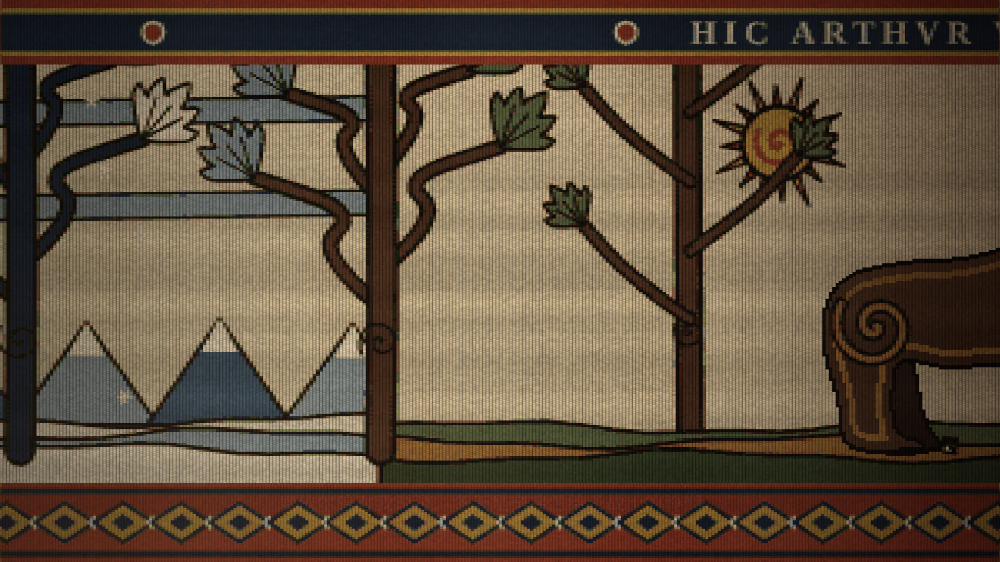

- **画面：**
  - 冬天的挂毯：天空两道浅菘蓝的云带，远山，卷枝纹的冬树成林。
  - 前景是战场：侧卧的死马、盾、头盔、折断的长矛、覆雪的低丘。
  - 右边一棵大树，旁边插着一杆长枪，枪头下系着红布条；白色的呼吸波纹从树后吹出。里加就在树后。
  - 铭文“HIC RIGA IN SILVA LATET”（此处里加藏身林中）。
- **动态：**
  1. 镜头沿挂毯缓慢推近大树；呼吸波纹一呼一吸地织出、淡去；远处马蹄声愈来愈近。
  2. 独白：“麦依尔曾对我说过，冬天是辛弗兰给予战士的怜悯。”
  3. 独白结束，镜头向右横移，经过里加藏身的大树。再往右是一棵分隔两景的树：左边的叶是冬天的浅菘蓝，右边是春天的绿。像贝叶挂毯用树隔开前后两个场景。
  4. 过了这棵树就是阿瑟的原野。铭文随花边一起移过来，“HIC ARTHVR VRSVS NIVEM SOLVIT”停在画面正中。

### 第二幕：大熊与寒鸦（00:25—00:59）

**镜头 05｜00:25—00:34｜大熊阿瑟**


- **画面：**
  1. 春天的原野，大熊四足站立，鼻息化作波纹融化积雪，嫩芽冒出。身后三棵卷枝树都很高，树冠伸出画面上方。铭文“HIC ARTHVR VRSVS NIVEM SOLVIT”。
  2. 鼓点落下，挂毯抖动，大熊重织为直立咆哮的姿态，鸟群惊飞。铭文“HIC ARTHVR VRSVS BELLVM CLAMAT”。
- **动态：** 姿态切换用织机式重织（从上到下逐纬扫过）。
- **独白：** “大熊阿瑟用它温暖的鼻息融化积雪，将露出的大地作为战场，吼叫着呼喊战争。”
- **软件功能：** 右上角是文舟的编辑器窗口，打开正文.txt：
  1. 拖选“阿瑟”，弹出“剪切 / 复制 / 粘贴 / 更多”；
  2. 更多 → 加入词库，打开对话框“选中词加入术语库”；术语库文件为“炉火祈愿/设定.gly”，释义填“大熊精魂”；
  3. 点“添加词条”，提示“词条已加入术语库”，正文里的“阿瑟”加上术语下划线。

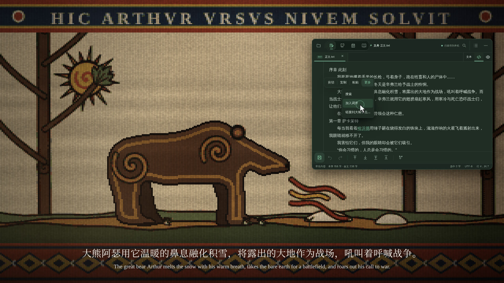

**镜头 06｜00:34—00:41｜沿着树上移**

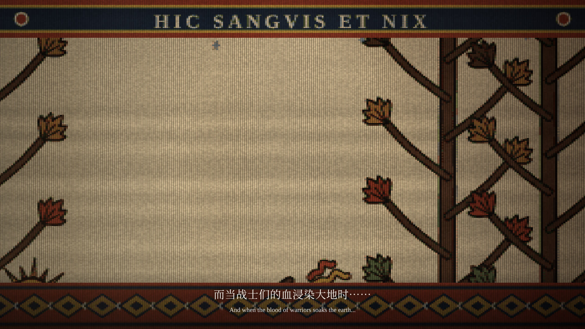

吼声落下，惊飞的鸟群向上飞去，镜头跟着沿右边那棵高树上移，同时慢慢推近这棵树。

- 一路上树叶由下往上从绿色转为茜草红（“而当战士们的血浸染大地时……”），再转为赭黄、胡桃褐，最后是漂白的霜叶。
- 树干后面渐渐出现雪山与两道云带，雪花纹样越来越密。
- 铭文先换成“HIC SANGVIS ET NIX”（此处血与雪），到树梢时换成“HIC SINFRAN MONEDVLA”。

**镜头 07｜00:41—00:52｜寒鸦辛弗兰**


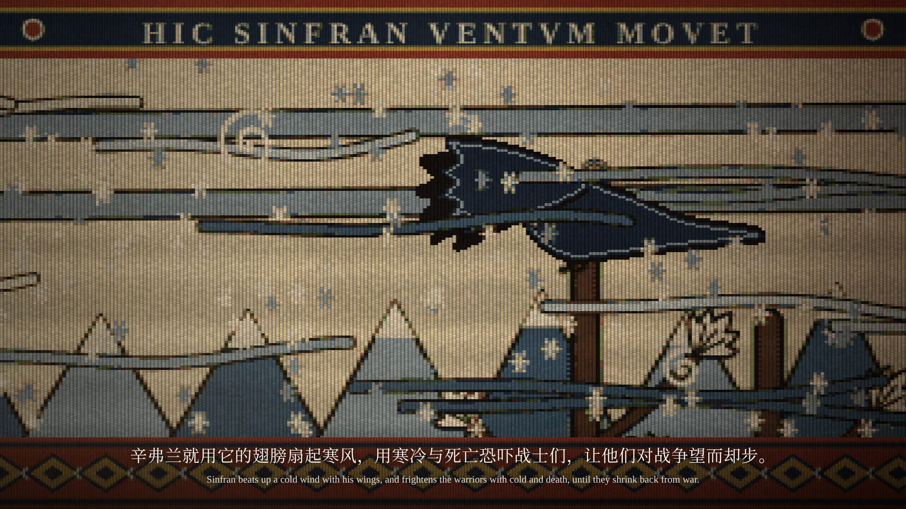

- **画面：**
  1. 修长的寒鸦停在这棵高树的树梢上，颈部一圈浅色领羽。铭文“HIC SINFRAN MONEDVLA”。
  2. 双翅高举，铭文换成“HIC SINFRAN VENTVM MOVET”。
- **动态：** 三次振翅各重织一个姿态，落在鼓点上。每扇一次，寒风就大一级：
  - 从右往左吹的风带更多、更宽、更快；
  - 风里卷起旋涡，雪花更密。
- **独白：** “辛弗兰就用它的翅膀扇起寒风，用寒冷与死亡恐吓战士们，让他们对战争望而却步。”
- **软件功能：** 左上角的编辑器窗口用同样的步骤把“辛弗兰”加入术语库，释义为“寒鸦精魂”；此时“阿瑟”已带着术语下划线。

**镜头 08｜00:52—00:59｜寒风盖满画面，散开时已是炉火**

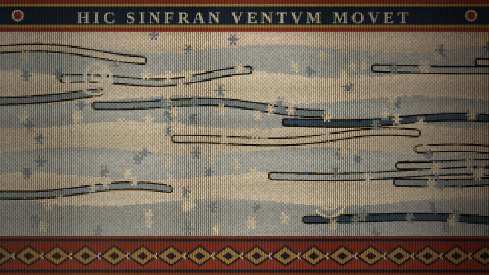
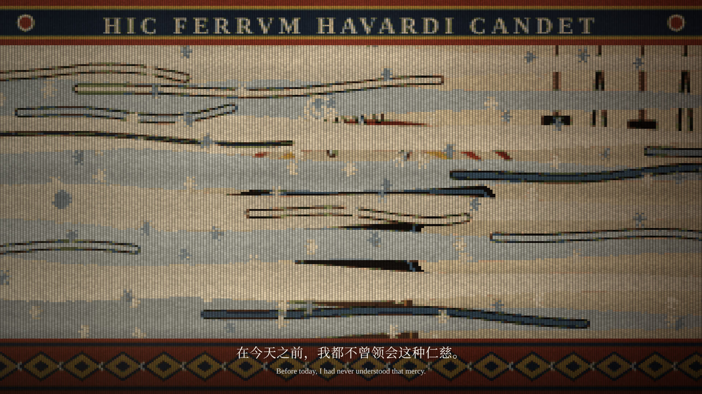

一只巨大的翅膀从镜头前掠过，寒风随即合拢。八道漂白与浅菘蓝的风带从右往左越来越宽，最后完全遮住画面，只剩风纹和雪花在里面流动。

独白：“在今天之前，我都不曾领会这种仁慈。”铭文在风中换成“HIC FERRVM HAVARDI CANDET”。

随后寒风从右边先散开，一路吹向左边，露出的是铁匠铺：炉火、铁砧和那块白热的铁，镜头已经离得很近。

### 第三幕：铁匠与少年（00:59—01:27）

**镜头 09｜00:59—01:11｜铁砧上的铁**


- **画面：** 纯侧面。左边是砌石的炉子，火焰织成扇形；墙上挂着锤与钳。铁砧立在木墩上，砧面上放着一块烧得发白的铁：铁心是漂白，边缘是木樨草黄，外圈是一道道茜草红的热浪弧线。蒸汽织成白色波纹升起。铭文“HIC FERRVM HAVARDI CANDET”（此处哈沃德的铁烧得发白）。没有锤，没有火星。
- **动态：** 镜头从寒风散开时的近景继续推近铁块，直到镜头 11。热浪弧线随炉火明灭，蒸汽波纹升起。
- **声音：** 铁在砧上嘶嘶作响，与低音鼓点相合。
- **独白：** “每当我看着哈沃德用锤子砸在烧得发白的铁块上，滋滋作响的火星飞着溅射出来，我眼睛就移不开了。”

**镜头 10｜01:11—01:22｜关系的建立**


- **画面：** 继续推近，铁块和蒸汽占据画面中部。
- **软件功能：** 右上角是文舟的炉火祈愿.pcs，切到“关系”视图：
  1. 从“哈沃德”的“＋”拖出连线，连到“里加”；
  2. 点连线打开“连线详情”，关系标签填“抚养与照料”；
  3. 点“保存关系”。

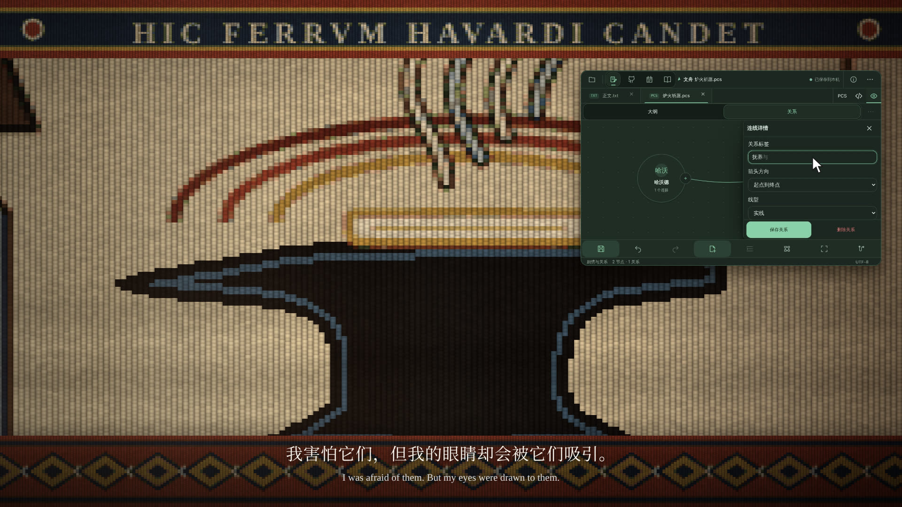
- **独白：** “我害怕它们，但我的眼睛却会被它们吸引。”
- **对白（哈沃德）：** “你会习惯的，人总是会习惯的。”

**镜头 11｜01:22—01:27｜白热变成雪**


推到铁块的白色占满两道花边之间的画面，整个画面变白；白色里织出浅浅的雪纹，就是镜头 12 的雪路，两根线的线头从画面下方织进来。最后一声嘶响化为风声与踩雪声。

### 第四幕：漫长的告别（01:27—02:08）

**镜头 12｜01:27—01:38｜两根线**


- **画面：** 俯视的雪路，从画面下方伸向上方。一根草绿色的线（哈沃德）在前，一根菘蓝色的线（里加）稍后，沿着道路两侧向上织出。铭文“HIC HAVARD ET RIGA PROFICISCVNTVR”（此处哈沃德与里加启程）。
- **动态：** 两根线的线头以步行速度向上织进；镜头随之上移，雪地、石头、枯草和树冠向下退去。哈沃德说完，线头放慢、停下。
- **对白（哈沃德）：** “就到这儿吧，从这里去海尔加德，一直骑上半天也就到了，不算远。”

**镜头 13｜01:38—01:56｜哈沃德的嘱咐（地图）**

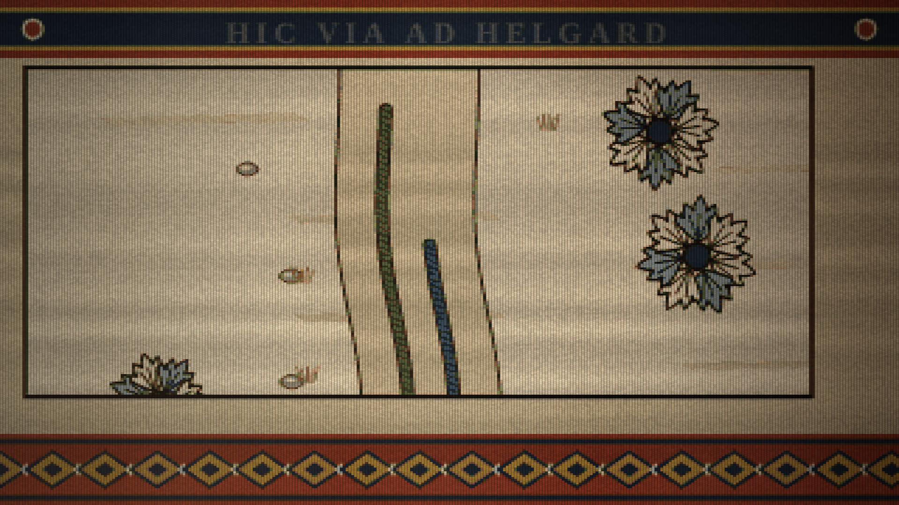


镜头像升高了一样：雪路的画面带着一道深色边框缩小，落到地图上萨卡莱特的位置，变成一点。随后地图一笔一笔织出来：因舍森的山、卷枝小树、柯戈德河、太阳纹罗盘，萨卡莱特、艾洛夫、盎讷、海尔加德之间是茜草红的虚线道路。织出的地图就是文舟的地图画布：

- 上方浮着瑞达内.vlmp 的真实工具栏（浏览 / 绘制点 / 信息点 / 删除 / 箭头 / 元素），光标先点“信息点”。
- 哈沃德每说到一个地方，光标就在那里点一下：那里织出房子，右侧弹出真实的“信息点”面板。
- 在面板的名称里逐字打出地名，点“保存信息点”，地图上随即织出地名。

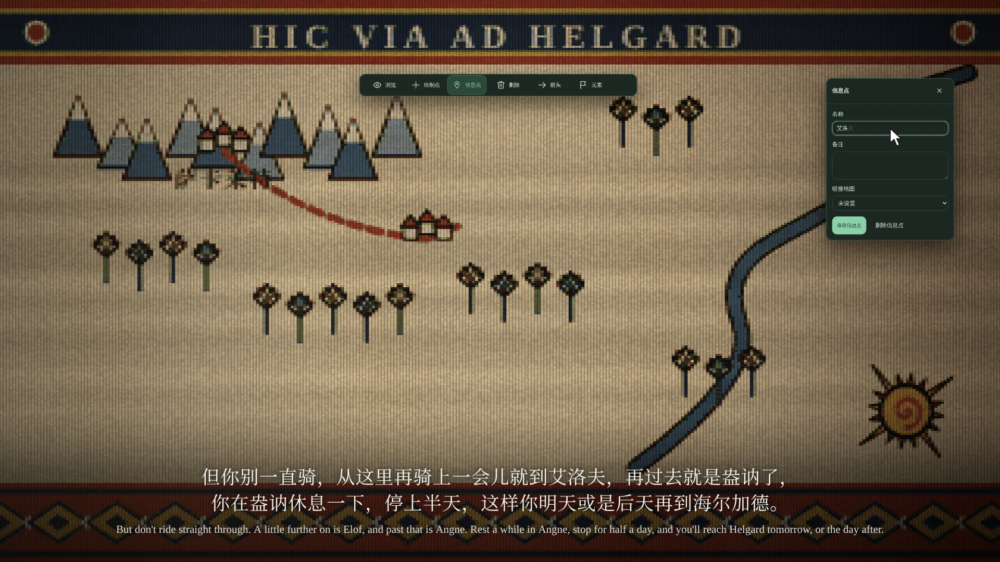

**镜头 14｜01:56—02:08｜拥抱**


- **画面：** 从地图上萨卡莱特那一点放大，回到雪路。两根线从路的两侧靠拢，相互缠绕三圈，像一股绳的两缕，然后都停在缠绕的上端。铭文“HIC RIGA ET HAVARD VALEDICVNT”（此处里加与哈沃德道别）。
- **动态：** 线头靠拢后一圈一圈地缠上去；停下后画面静止良久，只有炉火光明灭，音乐几乎静止。
- **对白（哈沃德）：** “我总在这儿，你别怕找不到我。”

### 第五幕：奔向未知（02:08—02:41）

**镜头 15｜02:08—02:17｜策马**


- **画面：** 鼓点响起，蓝线从缠绕的上端笔直地向上跑去，绷得紧紧的；绿线留在原地，线头停在缠绕的上端，正如哈沃德说的“我总在这儿”。铭文“HIC RIGA EQVITAT AD HELGARD”（此处里加骑向海尔加德）。
- **动态：** 蓝线的线头越织越快，镜头按平均速度追着它上移，线头始终在画面上部，随每一步向前冲出又落回；缠绕处和停在那里的绿线慢慢退出画面下方。
- **声音：** 马蹄声与鼓点同步，蓝线每一次向前跃进都卡在节拍上。

**镜头 16｜02:17—02:31｜流动的世界**


只剩一根蓝线在雪路上高速向上织去，两旁扬起雪尘。右侧滑入文舟炉火祈愿.pcs 的“大纲”视图：

- 随节拍一张张长出节点卡片：炉火祈愿 · 第一部 → 序章 · 此刻 → 逃亡的松林、大熊阿瑟、寒鸦辛弗兰 → 一、萨卡莱特 → 哈沃德的铁匠铺、离开萨卡莱特、前往海尔加德；
- 每张卡片都有概要；
- 窗口随新节点向下滚动。

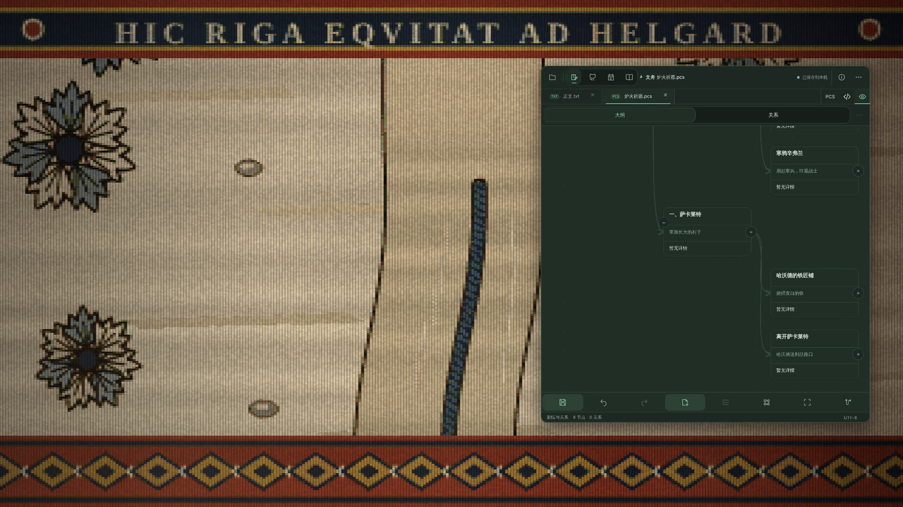

**镜头 17｜02:31—02:36｜最后的回忆**

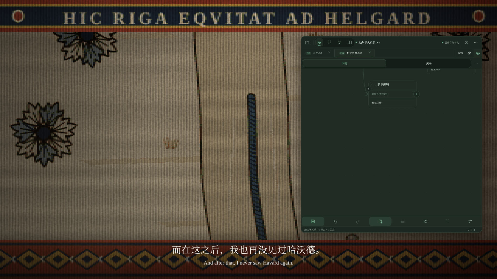

光标点“一、萨卡莱特”卡片上的折叠按钮，这一支收起，窗口随后滑走。蓝线仍在画面里向上跑，上下花边不动，花边之间的画面却越来越暗，像天黑了下来，只有线头周围还亮着。独白：“而在这之后，我也再没见过哈沃德。”

**镜头 18｜02:36—02:41｜奔入黑暗**

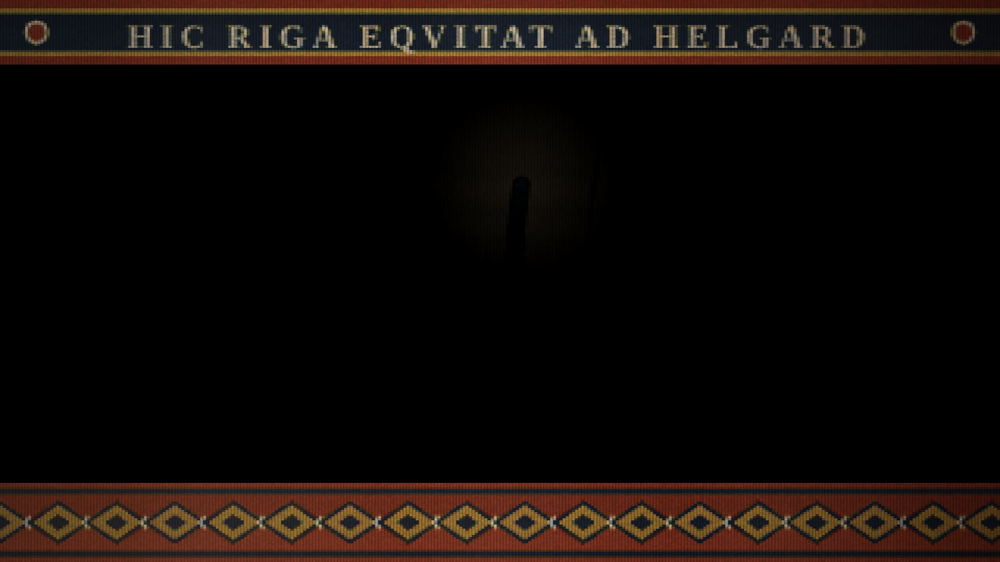

最后一点光收拢到线头上，熄灭；中间全黑之后，上下花边也暗下去。马蹄声在最后一个强鼓点戛然而止，黑场中出现文舟 Logo。

### 第六幕：文舟（02:41—02:49）

**镜头 19｜02:41—02:49｜终幕**


与开场同样的 0.9.8 式画面：图标、“文舟 Vela”、“0.9.9 · 让故事，自此起航。”、“现已上架鸿蒙应用市场”；几枚火星从下方升起，与开场的燃烧呼应。

## 四、制作方式

| 元素 | 实现 |
| --- | --- |
| 织锦 | `samples/loom.js`：在织造网格上绘制，按染料色板量化（含交错与染色条纹），再放大并叠加毛线肌理与炉火光 |
| 剪影 | `wFigure`：把动物或物件的各部分合成一个剪影，在网格上计算勾边与内轮廓线 |
| 两根线 | `yarn()` 画毛线；`topField()` 画俯视的雪路与随镜头移动的地面；`twine()` 画缠绕 |
| 固定的花边 | `film.js` 的 `bandsAt()` 单独织出两道花边，`woven()` 把镜头里的画面织好后嵌在花边之间 |
| 长挂毯 | `stripAt()` 把战场、分隔树和阿瑟的原野（连同高树和树梢的辛弗兰）排在同一幅布上，镜头按关键帧横移、上移、推近 |
| 寒风 | `windAt()` 画在画面之上、与画面一起织：风带、旋涡、雪花随振翅增强，盖满后再散开 |
| 地图的升降 | `insetAt()` 把雪路画面缩进地图上的萨卡莱特，或从那里放大回来 |
| 文舟界面 | `ui/capture.mjs` 在 Web 版里逐步操作并截图（`ui/shots/`、`ui/shots.js`）；`film.js` 的 `appWindow()` 按时间切换截图，`pointer()` 画光标 |
| 开场与落版 | 按 `promo/video.html`（0.9.8 宣传片）的配色、图标动画与波浪重绘 |
| 文舟功能 | 沿用前几版的界面层 |

```sh
node promo/0.9.9/storyboard/render.mjs        # → storyboard/frames/*.jpg
python3 promo/0.9.9/storyboard/sheet.py       # → storyboard/contact-sheet.jpg
```
